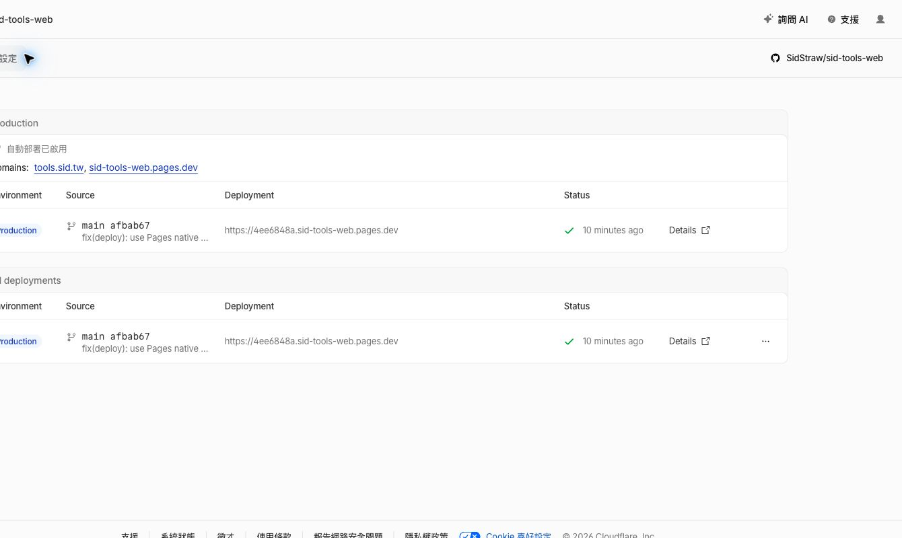
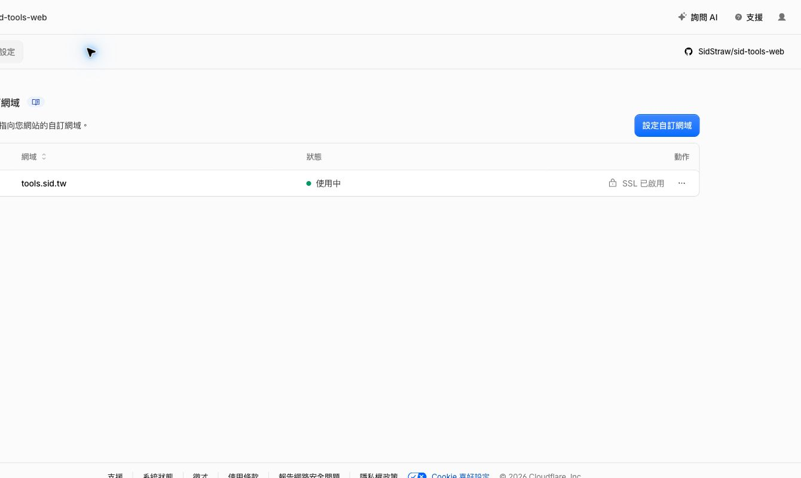
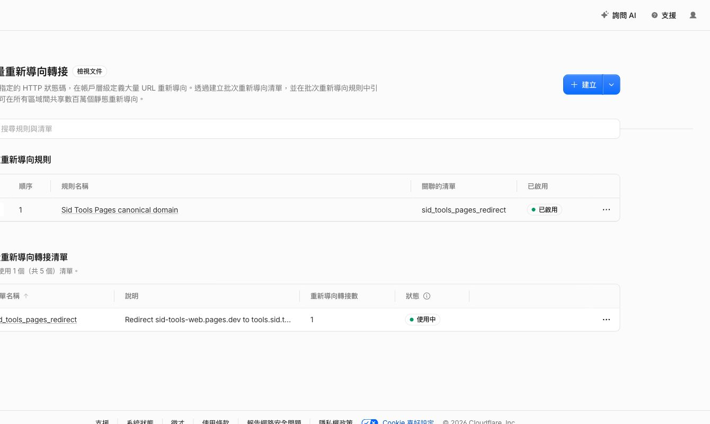
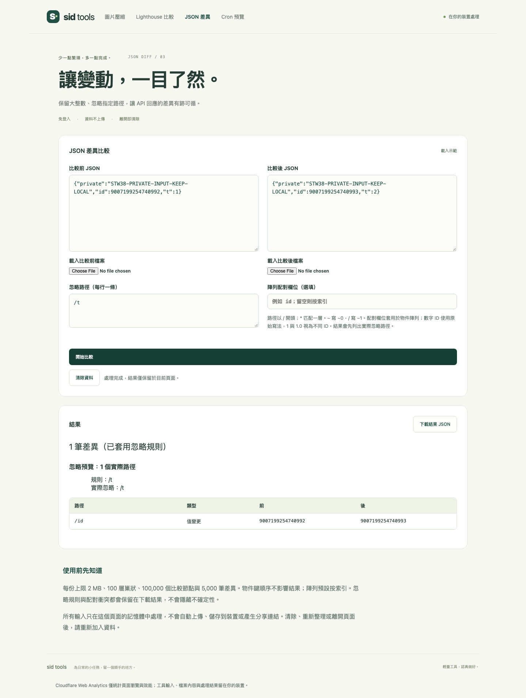
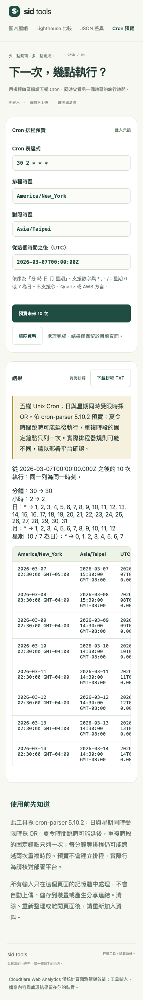
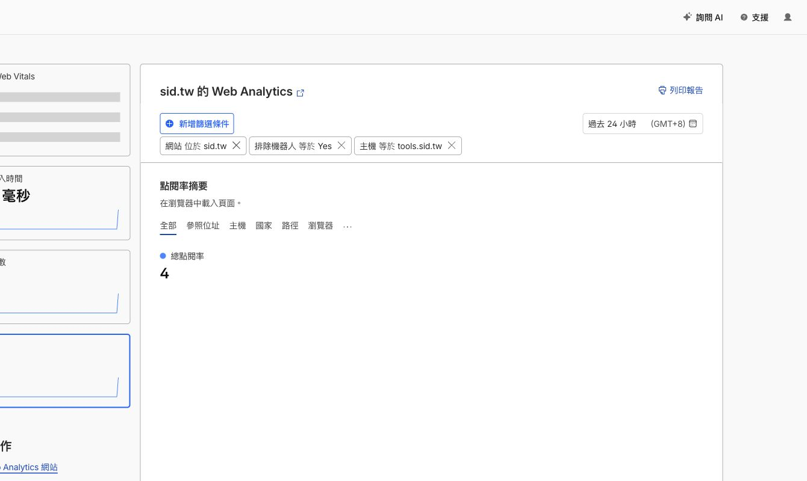

# tools.sid.tw Cloudflare 遷移驗收

日期：2026-10-15，任務 STW-38。正式入口：[tools.sid.tw](https://tools.sid.tw/)。使用者授權部署、repo 內安裝整合工具、停用 GitHub Pages，以及 commit/push 到 main；沒有新增部署 CI。

## 部署與整合：PASS

採用 **Cloudflare Pages 原生 GitHub 整合**，沿用既有 GitHub OAuth 授權。沒有建立 Workers Builds 的使用者 API Token，也沒有將部署憑證放入 repo。repo 內鎖定官方 Wrangler 4.149.0、workerd 2026-10-06，未全局安裝、未放寬三天發布等待期。

- 來源：`SidStraw/sid-tools-web`，生產分支 `main`，自動部署已啟用。
- 根目錄：repo 根目錄；建置：`pnpm build`；輸出：`apps/web/dist`。
- 建置環境：`PNPM_VERSION=12.8.2`、`NODE_VERSION=24.21.0`；與 packageManager / devEngines 相同。
- `wrangler.jsonc` 的 `pages_build_output_dir` 管理輸出；`pnpm deploy` 透過 `vp run` 建置並執行 repo 內的 `wrangler pages deploy`。
- 首次 Git 建置：commit `afbab670932908abadd25826b3b7fac4c7ac8360`，部署 ID `4ee6848a-1a58-442b-b176-d4fcf3e5949e`，clone/build/deploy 全部 success。
- Git 自動觸發實測：push `204925db4dae389ee4f269d84cd6fff8ed117ab1` 後，`deployment_trigger.type=github:push`；部署 `898cc659-0c7a-4cb4-a0ef-8613d26989c1` 於 `2026-10-15T11:08:24.604Z` 成功。
- `tools.sid.tw` CNAME 指向 `sid-tools-web.pages.dev`，Proxy 開啟。Pages domain / verification / validation 均為 active，SSL 已啟用。
- 遷移過程的臨時 Worker 已解除正式網域綁定；Worker 資產版本保留，workers.dev / preview 停用，沒有另一個公開入口。

## SEO 與舊站：PASS

四頁 SSG HTML、SPA 動態 metadata 與 sitemap 均指向 `tools.sid.tw`。未知路徑和不存在的 JS 回真正 404；路由保留 trailing slash。GitHub Actions 只剩 Linux/macOS Verify，沒有 Pages artifact 或部署 job；GitHub Pages API 已停用，舊站實際回 404。

Cloudflare 原生 Bulk Redirect 規則 `Sid Tools Pages canonical domain` 已啟用，清單 `sid_tools_pages_redirect` 只有一個來源 `sid-tools-web.pages.dev`，301 導向 `https://tools.sid.tw`，保留查詢字串、子路徑與路徑尾碼。沒有套用到其他專案。

實際 HTTP 驗證：

| 網址                                                         | 結果                                                    |
| ------------------------------------------------------------ | ------------------------------------------------------- |
| `https://tools.sid.tw/` 及三個深層工具網址                   | 200，正確 SSG / canonical                               |
| `https://sid-tools-web.pages.dev/tools/json-diff/?stw=route` | 301 → `https://tools.sid.tw/tools/json-diff/?stw=route` |
| `https://4ee6848a.sid-tools-web.pages.dev/tools/cron/`       | 200，`X-Robots-Tag: noindex`                            |
| `https://sidstraw.github.io/sid-tools-web/`                  | 404                                                     |

## 本機與公開站功能：PASS

`pnpm verify` 無任務快取：27 個單元／套件測試、19 個瀏覽器測試、格式 / lint / 型別 / production audit 通過。瀏覽器驗收使用官方 `wrangler pages dev`，包含根路徑、深層重整、SSG 無 JavaScript、按需載入、載入競態與錯誤恢復、手機排版、取消及不上傳。

GitHub [Verify 38723715383](https://github.com/SidStraw/sid-tools-web/actions/runs/38723715383) 的 Linux/macOS 皆 success。

[公開站實測 JSON](public-smoke.json) 於 `2026-10-15T11:04:59.461Z` 以隔離 Chromium 執行，未使用使用者瀏覽狀態：

- 圖片：真實 PNG 重新處理並下載，解碼確認 1024 × 1024。
- Lighthouse：真實 mobile/desktop JSON，匯出 performance delta 16 且保留量測條件警告。
- JSON：9007199254740992 / 9007199254740993 精確差異、忽略路徑與原始數字匯出。
- Cron：Worker 計算 10 個時刻，DST 範例 UTC 07:30，下載與剪貼簿包含時區。
- 選單、上一頁 / 下一頁共用 document；切換清除輸入，重整深層網址正常。
- 390px 無水平溢出、沒有 page error / CSP error，localStorage / sessionStorage 均無工具輸入。

## 基本頁面分析：PASS；自然流量成效尚未判定

沿用 `sid.tw` 既有 Cloudflare Web Analytics 自動安裝與「排除歐盟訪客」偏好，沒有新增重複 beacon 或 Pages 分析站點。DNS/網域移轉後曾暫時 522、未注入腳本；待 domain validation active 及設定傳播後，真實 Chrome 與隔離 Chromium 均確認官方版本化 beacon 載入。

正式站四個 SPA 路由均觀察到官方 `https://tools.sid.tw/cdn-cgi/rum` POST **204**。公開測試記錄只保留端點、狀態、路徑和欄位名稱，不保留 siteToken / pageloadId 值；測試輸入標記沒有出現在 POST，所有非 GET 都只有官方 RUM，沒有檔案上傳。

[工具站頁面報表（需登入）](https://dash.cloudflare.com/3a87f6e3222f46be8ffc89c0416a1189/web-analytics/overview/page-views?siteTag~in=b15c9a625f28462ebf3c8aa6be4c6c66&excludeBots=Yes&host=tools.sid.tw) 已篩選 `host=tools.sid.tw`。可查看 page views、visits、路徑、參照來源、國家、瀏覽器 / 裝置與 Core Web Vitals；新站資料仍需累積，不把驗收流量當成自然搜尋需求。

`2026-10-15T11:08:34Z` 儀表板已顯示 3 visits / 4 page views，含首頁與 Lighthouse 路徑，以及 1 次軟式導覽；這只是報表入庫證據，數字包含驗收活動，不作自然流量成效宣告。

統計可能受排除歐盟、機器人過濾、廣告阻擋器及網路影響。Edge 資源請求數不是人數；此版本沒有自訂工具成功事件、UTM 歸因或 Google 關鍵字曝光資料。工具輸入、檔案及結果仍只在瀏覽器處理。

## 官方來源

- [Pages Git integration](https://developers.cloudflare.com/pages/configuration/git-integration/)
- [Wrangler Pages configuration](https://developers.cloudflare.com/pages/functions/wrangler-configuration/)
- [Redirect pages.dev to custom domain](https://developers.cloudflare.com/pages/how-to/redirect-to-custom-domain/)
- [Preview noindex](https://developers.cloudflare.com/pages/configuration/preview-deployments/)
- [Web Analytics FAQ](https://developers.cloudflare.com/web-analytics/faq/)
