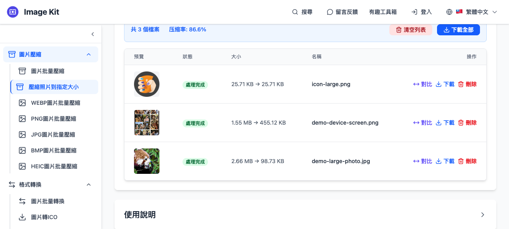
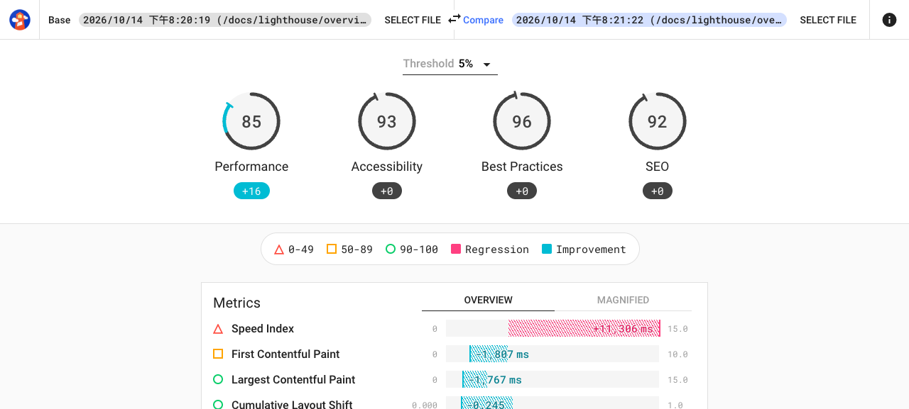

# STW-34／STW-16：真實樣本競品實測與搜尋需求

日期：2026-10-14。範圍：研究與 Backlog 更新，沒有產品實作。排序仍為 **STW-34 → STW-16**，兩者維持 **Medium / Needs Refinement**；這是後續驗證順序，不是已核准開發。

## 決策

| 卡片 | 已有實測證據的差異 | 暫時排除的低增量範圍 | 下一個投入門檻 |
|---|---|---|---|
| STW-34 | 指定大小後，逐檔呈現大小、尺寸、格式及透明度是否同時達標；不可達成時說明取捨；避免不必要增肥 | 單純批次、指定 KB、ZIP、透明 WebP、預覽：競品已有，不能單獨當賣點 | 用真實上傳規範確認有人同時受這些限制；明確目標國家與格式。既有工具可直接滿足時停止；不以重新包裝壓縮器立案 |
| STW-16 | 官方比較器在本輪 mobile／desktop 報告中未直接提示裝置及節流差異，仍顯示 Performance +16；先檢查可比性有具體比較基線 | 一般兩檔分數／audit diff 已成熟；不擴成多頁矩陣或監控服務 | 取得實際使用者的報告比較案例與可觸及管道，確認條件警告能改變判讀／省下檢查時間。沒有採用證據時不靠廣詞流量啟動 |

**AI 替代判斷仍是待驗證假設**：AI 可讀 JSON、寫圖片轉換腳本，本輪沒有同樣本 AI 操作測試，不能宣稱 AI 做不到。可能增量是可重複的檔案操作與可審查結果，不是解釋文字。

## 方法與可重現範圍

- 依使用者要求，用 `agent-browser --session <獨立名稱>` 的 headless Chrome 測試；沒有帶 profile、登入狀態或連到個人 Chrome。使用現有 agent-browser，沒有全局安裝。
- 將未改動的公開圖片選入競品，下載真正輸出，以 Pillow 檢查 bytes、格式、尺寸、alpha 與 SHA-256。完整樣本來源在 [圖片 manifest](samples/images/manifest.json)，結果在 [Image Kit measurements](outputs/imagekit-100kb-measurements.json)、[Compress Picture measurements](outputs/compress-picture-measurements.json)。圖片為 Squoosh 固定 commit 的公開既有素材，非人工合成測試圖；不是客戶實際上架素材或已驗證上傳規範。素材權利仍屬原來源，不能由可下載推論可任意商用。
- Lighthouse 以專案研究目錄內安裝的 12.6.1 CLI，對 Chrome 官方文件頁真正跑兩次 mobile、一次 desktop，再把未改動 JSON 選入比較器。[執行方式與樣本限制](samples-lighthouse.md)、[報告 manifest](samples/lighthouse/manifest.json)。沒有修改受測網站或手改分數。
- 每個圖片流程完成一輪；不是可靠度／長期效能研究。沒有計時、網路隱私稽核、手機操作或盲測畫質。頁面宣稱瀏覽器本機處理不等於本輪已驗證沒有上傳。
- Lighthouse 官方 fixtures 另有保留，但本輪比較器實測結論來自三份 live 報告；未實測跨主版本、缺欄位、不同 URL。PNG 以外的動畫、EXIF 方向及大批次容量也未測。

## STW-34：同一批真實圖片

| 樣本 | 輸入大小 bytes | 輸入尺寸 | 特性 |
|---|---:|---|---|
| demo-large-photo.jpg | 2,790,013 | 3872 × 2592 | 紅熊貓照片，RGB，沒有 EXIF orientation 情境 |
| demo-device-screen.png | 1,622,142 | 706 × 1442 | 手機畫面，RGBA，有透明區域 |
| icon-large.png | 26,322 | 1024 × 1024 | 小型 PNG 圖示，有透明區域，原本已小於目標 |

### A. Image Kit 指定大小壓縮

[實測入口](https://imagekit.lzw.me/zh-TW/compress-image-to-kb)。選三檔，目標由預設 200 改 100 KB，保留原格式，按壓縮，下載全部 ZIP；真實輸出保存在 [outputs/imagekit-100kb.zip](outputs/imagekit-100kb.zip)。

| 檔案 | 輸出 bytes | 尺寸／格式 | 實測判斷 |
|---|---:|---|---|
| photo | 101,096 | 3872 × 2592 JPEG | 小於 100 KiB（102,400 bytes），大於十進位 100 KB（100,000 bytes）；UI 98.73 KB，不能直接套用所有網站的 100KB 規則 |
| screen | 466,039 | 706 × 1442 PNG | 兩種 100KB 上限均超出；UI 455.12 KB，仍列「處理完成」、可下載，該列未顯示超標原因 |
| icon | 26,322 | 1024 × 1024 PNG | 與原圖 SHA-256 相同，保留原本小檔案，此點值得沿用 |

透明區域仍存在；screen 的 alpha range 為 0–255，但不等於逐像素完全不變。照片壓縮後目視可見色階／斑塊，沒有客觀同品質對照或盲測，不能宣稱另做的引擎畫質更好。

**FAIL 僅指本輪 screen 的指定大小條件，以及逐檔未達標原因的呈現**，不是宣稱工具整體不能用。「處理完成」也不能曲解為明確承諾「符合目標」；頁面 FAQ 已概述某些圖無法達標及縮尺寸建議。值得做的是把這個判斷帶到每個結果旁。批次、ZIP 下載、保留小圖則已實測通過。

[設定截圖](evidence/imagekit-100kb-settings.png) · [完整可讀頁面](evidence/imagekit-100kb.txt) · [控制項快照](evidence/imagekit-100kb-snapshot.txt)

### B. Compress Picture 的 100KB 流程及透明 PNG 替代流程

[100KB 入口](https://compress-picture.com/compress-image-to-100kb)。同三檔，目標 100KB，額外「Resize if larger than 2560 px」未勾選。選檔後自動處理，逐一下載。

| 檔案 | 輸出 bytes | 尺寸／格式 | 結果 |
|---|---:|---|---|
| photo | 102,170 | 1499 × 1003 JPEG | 達 100KiB，但自動縮小尺寸；沒有達十進位 100KB |
| screen | 102,268 | 706 × 1442 JPEG | 達 100KiB，透明背景被白色取代；沒有達十進位 100KB |
| icon | 76,356 | 1024 × 1024 JPEG | 已小於目標的原圖反而增至約 2.90 倍，UI 減少比例顯示 −0%；未保留透明度 |

**不能把縮尺寸／轉 JPEG 說成未披露行為**：FAQ 明確解釋品質不足時會縮尺寸，也說明 PNG 會轉 JPEG、透明區變白。這條流程已可靠產出本輪三個小於 102,400 bytes 的檔案；單純「壓到100KB」不是未解需求。

另實際開啟 [Compress PNG](https://compress-picture.com/compress-png)，同兩張 PNG、預設 quality 75／WebP、未勾尺寸限制，選檔後處理。下載 screen 得 **130,530 bytes、706 × 1442 WebP，alpha 逐像素與原檔相同**。此頁有格式、品質與尺寸控制，但當次控制項未見目標 KB；因此「保留透明度」已有競品能做，剩下的是約束整合與取捨回報，不是格式能力缺口。沒有嘗試手動反覆調品質求 100KB，不能推論此競品無法手動做到。

[100KB 可讀結果](evidence/compress-picture-100kb.txt) · [100KB 截圖](evidence/compress-picture-100kb.png) · [PNG 頁結果](evidence/compress-picture-png.txt) · [WebP alpha 檢查](outputs/compress-picture-png-measurements.json)

## STW-16：官方 Lighthouse CI Diff Tool

[實測入口](https://googlechrome.github.io/lighthouse-ci/difftool/)。兩個 JSON 檔案選擇框，Base 使用 mobile A；Compare 先用 mobile B，再換 desktop。

| 場景 | 原始報告分數 | 實際畫面 | 結論 |
|---|---|---|---|
| 同頁同設定 mobile A/B | Performance 69→67；Best practices 96→79 | 顯示 67、−2 與 79、−17，以及 audit 差異 | 匯入與一般比較 PASS，不能把基本兩檔 diff 當新增價值 |
| 同頁不同設定 mobile A/desktop | Performance 69→85；formFactor 與 throttling 不同 | 顯示 85、+16、Improvement／Regression 圖例；本輪完整可讀頁面、控制項及 title 沒有直接提示條件差異 | 可比性提示缺口已在此案例重現；不等於此頁宣稱已證實程式改善 |

兩份 mobile 的 `configSettings` 相同但自然採樣結果不同，Best practices 變化對應 third-party-cookies audit。這只是說明單次分數不能證明因果，不能以兩次執行估算完整波動分布。live mobile 的終端有 Lantern dependency-cycle 訊息，三份報告均有語系轉址警告；原始報告沒有 runtimeError。這些限制不妨礙驗證「能否讀入、是否提示設定差異」，卻限制了效能結論。

本輪沒有看到原生匯出比較摘要的控制項；仍可人工閱讀／保存原始 JSON，不能宣稱不存在其他輸出方式。原卡匯出需求維持待驗證價值，不視為已證明需求。也未測跨版本相容性，不能把版本缺口判為 PASS 或 FAIL。

[同條件結果](evidence/lighthouse-same-settings.txt) · [同條件截圖](evidence/lighthouse-same-settings.png) · [異條件結果](evidence/lighthouse-mixed-settings.txt) · [異條件控制項](evidence/lighthouse-mixed-settings-snapshot.txt) · [title／連結檢查](evidence/lighthouse-mixed-titles.json)

另檢查 [Lighthouse AI Metrics 比較頁](https://www.lighthouse-aimetrics.com/compare-lighthouse-runs)：公開頁宣稱同 monitor 比較、noise 標記及 median 基線；需登入／建立 monitor，沒有操作其登入後服務，故 **NOT RUN**，不能說競爭者都沒解決可比性問題。保存 [公開文字](evidence/lighthouse-aimetrics-marketing.txt)。本輪確認的是免登入、上傳既有兩份 JSON 的官方工具缺口，不是完整市場排他性。

## 搜尋需求對排序的影響

完整查詢、國家、cache 日期、來源與限制見 [search-demand.md](search-demand.md)，原始 [API JSON](search-demand-api.json) 與 [Trends CSV](google-trends-us-12months.csv) 已保存。

- STW-34：seodata.dev 第三方回傳 US `compress image to 100kb` 170/月、`bulk image compressor` 480/月；IN 同 100KB 詞 49,500/月。支持指定大小／批次意圖，沒有證明交集需求、可獲排名或收入。不同國家不可混用，近似詞不可加總。
- STW-16：US `lighthouse report` 720/月、`lighthouse ci` 170/月屬廣意圖；四個 compare／diff 詞沒有取得正向月量。API 回 0 的語義未公開，不能判成零需求。Trends 精確比較詞 53 週為 0 且資料不足，也不能證明沒人搜尋。
- 提供者稱 Google Ads API 來源，本輪不是直接 Google Ads 帳號匯出；基礎統計期間、語言／聯播網設定不明，有些 cache 已數月，沒有第二份精確詞量交叉驗證。數字是有限第三方估算，廣告 competition 不是 SEO 難度。
- 搜尋結果只用來找來源，不是固定地區 Google 排名採樣。兩類都有成熟替代品，沒有證據支持「低競爭」；本輪不升 High、不轉 To Do、不新增卡片。

## 後續門檻與本輪驗證

方法採用專案內 [mk-013](../../.agents/skills/mk-013/SKILL.md) 與 [mk-243](../../.agents/skills/mk-243/SKILL.md)。本專案尚未實作，因此下列利益是待驗證的產品假說，不是本產品已勝過競品。

| 事實特點 | 顧客任務 | 可感受利益 | 比較依據 | 適合切角 | 主打／支持／待查 | 理由 |
|---|---|---|---|---|---|---|
| 34：Image Kit 的 screen 超過目標；CP 的達標路徑有尺寸／透明度取捨 | 產出符合上傳規範的多張圖，真實規範與頻率待補 | 減少逐檔檢查／重試，尚未量測 | 同三檔實際輸出與 UI | 逐檔約束檢查與可解釋取捨 | 待查；可作下一輪主打假說 | 基本壓縮／批次已有；未證明使用者會因此改用 |
| 16：官方 diff 未直接提示本輪 mobile／desktop 差異 | 確認兩份報告是否可比，再解釋變化 | 降低誤讀／人工比設定成本，尚未量測 | 三份真實報告、兩個對照場景 | 先可比性、後差值 | 待查；有功能基線支持 | 尚無精確流量或使用者採用證據；其他 SaaS 宣稱已有 noise 處理 |

mk-243 的真實 Search Terms、成本與有效結果在本輪**不可取得**。下面另列的是研究者選定關鍵字，不能充當實際帳戶搜尋字詞。缺資料屬未觀察，沒有使用者紀錄明確反對需求，不能列為相反需求證據。

| 搜尋字詞 | 原關鍵字與群組 | 成本／結果 | 意圖適配 | 問題類型 | 建議動作 | 影響範圍 | 審核 |
|---|---|---|---|---|---|---|---|
| 真實 Search Terms 未取得 | 34：研究字 `compress image to 100kb`、`bulk image compressor` | 未知；只有第三方月量 | 各支持大小上限／批次的一部分，交集未觀察 | 約束任務需求待驗 | 驗證真實上傳規範、國家與競品完成率 | 保留第一驗證位，不啟動開發 | 第三方估算，非帳戶搜尋紀錄 |
| 真實 Search Terms 未取得 | 16：研究字 `compare lighthouse reports` 等 | 未知；精確詞無正向量，廣詞 report 720 | 廣詞不能支持比較意圖 | 使用／分發需求未觀察 | 優先找案例與可觸及使用者 | 保留第二驗證位，不以 SEO 規模立案 | 不把 API 0 當相反需求證據 |

STW-34 下一步應驗證真實提交規範與同時約束的頻率，尤其若流量機會偏印度英文查詢，不可默認台灣繁中就有相同機會。STW-16 下一步先驗證目標使用者能否取得兩份 JSON、是否因條件提示改變判讀，以及從何處接觸這些人。兩者都應先測現有工具／AI 可完成的流程；若沒有明顯增量就停止新增獨立工具。

卡片用 Backlog CLI 追加研究紀錄與文件連結。原始 AC、描述與既有研究保持可追溯；不以競品測試勾選本專案 AC。更新前後及 CLI 結構檢查保存在 `card-verification.json` 與 `cards-before.json`／`cards-after.json`。
